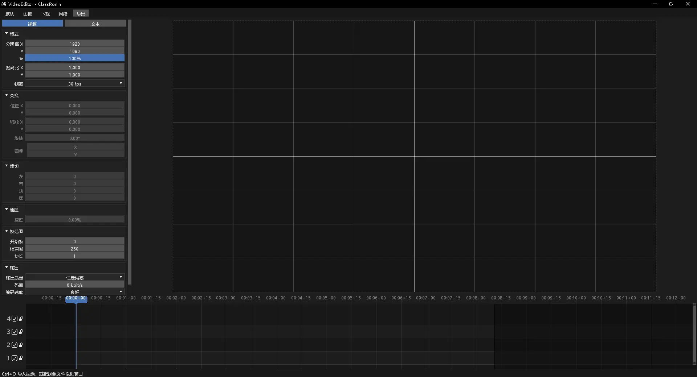

# VideoEditor

借鉴 Blender VSE 而做出简易的视频编辑器，个人使用，如果你喜欢就拿去用。

拖视频扔视频编辑器即可打开，高效使用追踪运动，文本。预览每帧都精确显示且导出一致性，丝滑的播放可能一般（当然不是用来做播放器），只能导出mp4。

导入导出需要FFmpeg，但它有下载，点击下载即可，如果你的PATH有FFmpeg，它能用。

下载 [ VideoEditor ](VideoEditor.zip)

